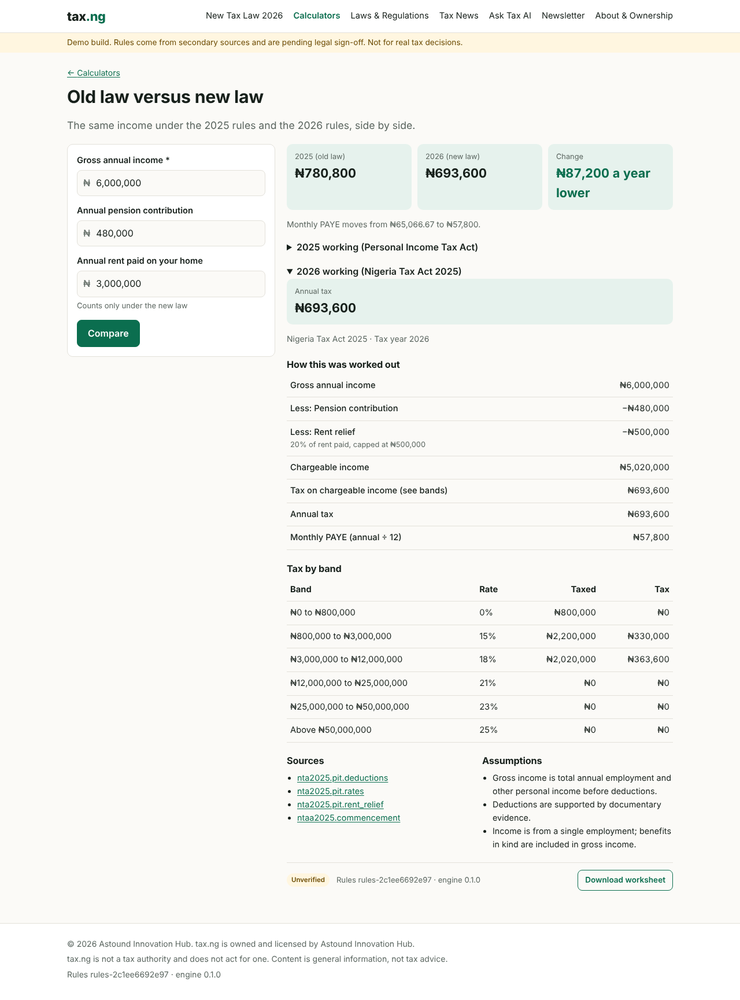
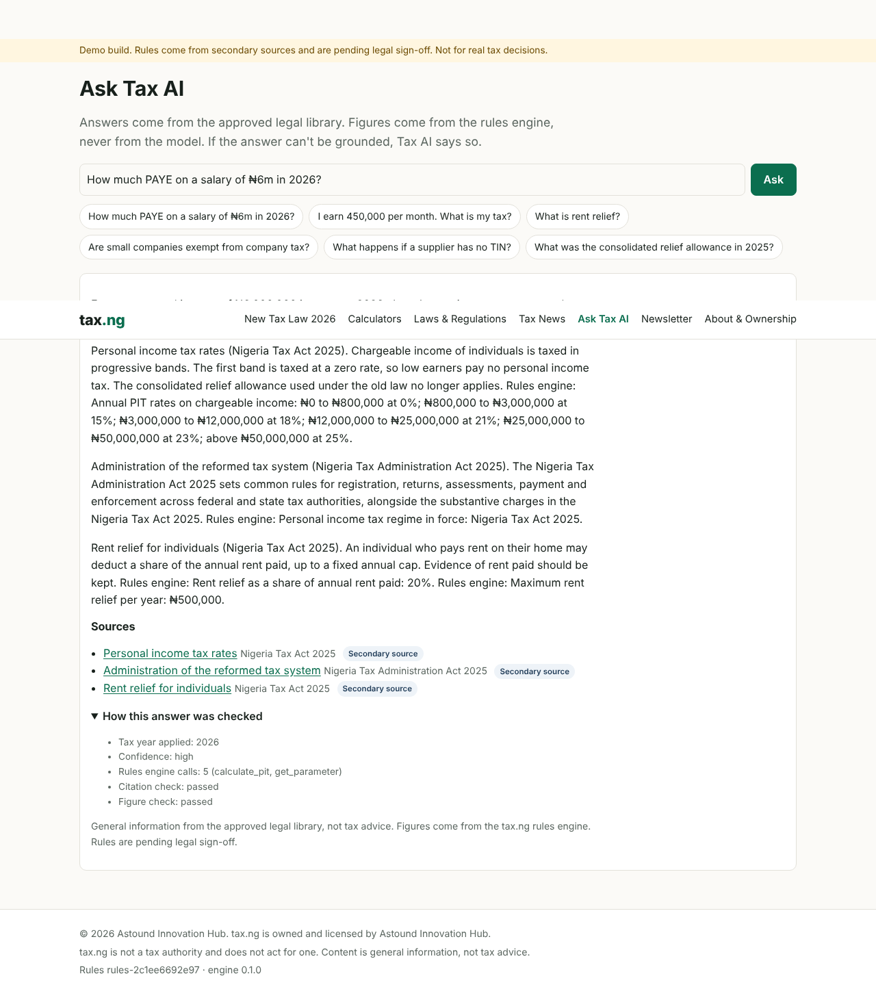
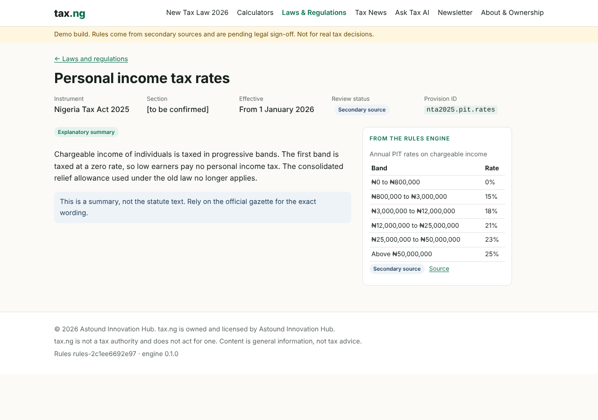
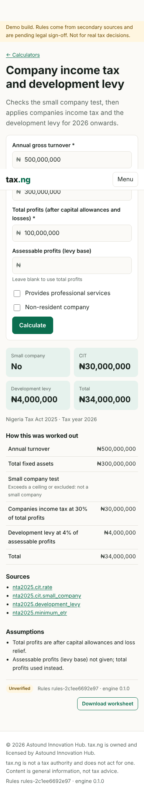

# tax.ng — Phase 1 demo

Working demo of the Phase 1 scope in *TAX.NG Product Requirements and Technical
Architecture* ("the PRD"): the 2025 tax reform, explained and calculated.

Owned and licensed by **Astound Innovation Hub**. © 2026. All rights reserved.

> **Demo status.** Tax figures are transcribed from PwC Worldwide Tax Summaries
> (a secondary source) and carry `secondary_source` or `unverified` status. No
> rule is `legal_approved`. Section references show "[to be confirmed]" until a
> legal reviewer checks the gazetted text. Do not use for real tax decisions.

## What is in it

| Area | What works | PRD IDs |
|---|---|---|
| Rules engine | Effective-dated parameters in OpenFisca YAML format; content-hash rules version; per-calculation audit trail and review status | CALC-07, NFR-06, ADR-02 |
| Calculators | PIT/PAYE (2026 NTA and 2025 PITA), old-versus-new comparison, CIT + development levy, VAT, WHT; steps, bands, citations, assumptions, CSV worksheet | CALC-01 to 05, 08, 09 |
| Legal library | Provisions with in-force dates, review status and live figures from the engine | LAW-01, 02, 05 |
| Reform hub | Guides linked to provisions and calculators | LAW-04 |
| Tax AI | Retrieval, rules-engine tool calls, citation guard and figure guard, escalation | AI-01 to 04 |
| News, newsletter | Nigeria section (sample items); signup with explicit consent and signed unsubscribe | NEWS-01 to 04 |
| Analytics | First-party events with whitelisted properties; summary endpoint | AN-01 to 03 |
| Governance | About and ownership page; Phase 1 navigation only | GOV-01, PRD s.5 |

Full traceability: [docs/REQUIREMENTS.md](docs/REQUIREMENTS.md).
Deviations from the target stack and why: [docs/DECISIONS.md](docs/DECISIONS.md).

## Run it

Requirements: Python 3.11+, Node 20+.

```bash
make install     # pip install -e backend[dev]; npm install in frontend
make test        # 46 backend tests, incl. 18 legislative worked examples
make web         # build the frontend into frontend/dist
make run         # http://127.0.0.1:8000
```

Without `make`:

```bash
cd backend && pip install -e . && python -m unittest discover -s tests -t .
cd ../frontend && npm install && npm run build
cd ../backend && python -m taxng
```

Environment variables (all optional for local use): `TAXNG_SECRET` (signs
unsubscribe tokens; **required in production**), `TAXNG_DB` (SQLite path),
`TAXNG_RULES_DIR`, `TAXNG_CONTENT_DIR`, `TAXNG_WEB_DIST`.

## Repository map

```
rules/
  parameters/        Tax rules as data (OpenFisca layout). The only place figures live.
  tests/             Legislative worked examples; every rule change must keep them green.
content/             Provisions, reform guides and news (CMS stand-in). No figures allowed.
backend/taxng/
  rules/engine.py    Parameter loader, effective-date lookup, marginal scales, audit view.
  calculators/       pit.py, cit.py, vat.py, wht.py and shared input/result types.
  legal/             Content loader with integrity checks; BM25 search.
  ai/assistant.py    Tax AI pipeline and the two guards.
  api/handlers.py    Framework-free API: plain functions, one dispatch().
  api/app.py         Thin Starlette adapter, static files, security headers.
  store.py           Newsletter and analytics (SQLite stand-in for PostgreSQL).
backend/tests/       Unit, contract and legislative tests.
frontend/src/        React + TypeScript; pages/, components/, api.ts (typed client).
docs/                Decisions log and requirement traceability.
```

## Suggested review order

1. `rules/parameters/pit/nta2025.yaml` and `rules/tests/legislative_cases.yaml`:
   the rules as data, and the worked examples a tax reviewer can check by hand.
2. `backend/taxng/rules/engine.py`: how a value is chosen for a date, and how
   every lookup is recorded.
3. `backend/taxng/calculators/pit.py`: regime selection by date, with no figures
   in code.
4. `backend/taxng/ai/assistant.py`: `guard()` and `Assistant.answer()`, plus
   `tests/test_ai.py::BadProvider`, which shows a fabricated answer being blocked.
5. `backend/taxng/api/handlers.py`, then `frontend/src/api.ts`.

## Rules you must not break

- **No figures in code or content.** Rates, bands and thresholds live only in
  `rules/parameters`. `Library.load` rejects provision or guide text containing
  ₦ amounts or percentages.
- **The AI never states a number of its own.** Every ₦ amount and percentage in
  an answer must match a rules-engine tool result, or the answer is withheld.
- **Citations come from retrieval.** The AI may cite only provisions retrieved
  for that question.
- **Review status is honest.** `test_no_rule_is_legally_approved_yet` fails if a
  status is flipped to `legal_approved`; changing it is a deliberate, reviewed act.
- **Money is Decimal end to end.** The API returns decimal strings; the frontend
  formats them and never does tax arithmetic.

## Changing a rule

1. Edit or add the value under `rules/parameters` with its start date. Never
   overwrite history: add a new dated entry.
2. Add or update a worked example in `rules/tests/`.
3. Run `make test`. The rules version (a content hash) changes automatically.
4. In production, the change needs approval from two named legal reviewers
   (CODEOWNERS on `rules/`; see PRD Annex A5).

## Screenshots

| Old vs new law | Tax AI with guard trace |
|---|---|
|  |  |
| **Law page with live engine figures** | **CIT on mobile** |
|  |  |
